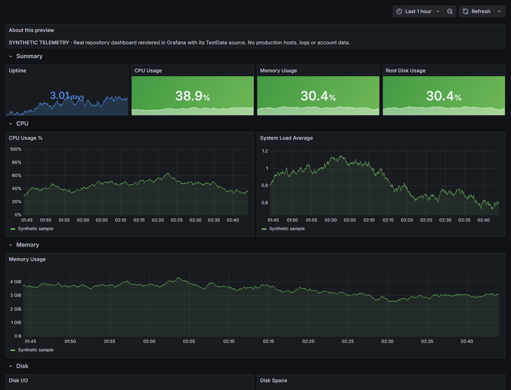

# Observability Stack

Logs, metrics and traces for Docker Compose applications, with Grafana dashboards and a read-only MCP interface for investigating project health.

Applications join one shared network and use `obs.*` labels to opt in. OpenTelemetry collects telemetry; Loki stores logs, Prometheus stores metrics, and Jaeger stores traces. Grafana connects the signals. Optional satellite collectors forward signals from another Docker daemon.

## Dashboard preview



[Collector screenshot](docs/media/collector-dashboard.png) · [Watch the dashboard walkthrough](docs/media/dashboard-walkthrough.mp4) · [Animated preview](docs/media/dashboard-walkthrough.gif)

These captures render the real dashboard layouts in Grafana with its built-in TestData source. Every capture carries a synthetic-data banner. They demonstrate presentation, not connected production telemetry or end-to-end ingestion. [Reproduce the preview](docs/demo/README.md).

## Run locally

Use a Linux host with Docker Engine, the Docker Compose plugin, and the default Docker container-log directory. The collector and Prometheus mount the Docker socket; this is trusted host administration software. Docker Desktop and rootless Docker need their own mount configuration and are not verified by this edition.

```sh
cp .env.example .env
# Fill the three secret values, generating each independently:
openssl rand -hex 32
./obs.sh config --quiet
./obs.sh up -d --build
```

Open http://localhost:3003 and sign in as `admin` using your chosen password. Start with the Overview dashboard. Host ports bind to loopback; other containers send OTLP to `otel-collector:4317` on the `observability` network. Configure an authenticated TLS proxy or private transport yourself before remote access.

Grafana's port is fixed at 3003 by default. If you change it, also update its target in `prometheus.yml` and the smoke-test harness. Retention is configured in the actual Loki, Jaeger and Compose configuration, not through unused environment variables.

## Connect an application

See [CONNECTING.md](CONNECTING.md) for labels and network configuration, and [AGENTS.md](AGENTS.md) for the MCP tool reference. MCP uses `http://localhost:8000/mcp` with `Authorization: Bearer <MCP_API_KEY>`. Without a configured key the tools reject requests; `/health` and `/public/health` remain unauthenticated.

`PUBLIC_PROJECTS` defaults to empty. Explicit `namespace:Display Name` entries allow public aggregate project status; they never publish individual log lines. Stack component health remains public. Keep that endpoint private if you do not want component status exposed.

## Verify

```sh
python -m pip install PyYAML
python scripts/validate.py
./obs.sh config --quiet
./obs.sh up -d --build
docker compose -f tests/docker-compose.test.yml up --abort-on-container-exit --exit-code-from smoke-test smoke-test
docker compose -f tests/docker-compose.test.yml down
```

The test application uses synthetic telemetry. The smoke test checks readiness and API responses; it is not proof of complete end-to-end trace delivery or production capacity. See [PUBLIC_RELEASE.md](PUBLIC_RELEASE.md) for the checks performed during preparation.

## Operations and scope

`./obs.sh logs -f`, `./obs.sh ps`, and `./obs.sh down` manage the local stack. `./backup.sh` creates volume backups; test restoration before relying on it. Optional host mail alerts are described in [alerting/README.md](alerting/README.md). Satellite settings must name your own private collector endpoint.

This public edition contains generic local configuration and validation-only CI. It does not deploy to an existing server or probe the author's services. Infrastructure access controls, upgrades, retention tuning and redaction of application telemetry remain operator responsibilities.

No project licence is granted in this edition yet. Choose one after confirming ownership of the original code; upstream components retain their own licences.
